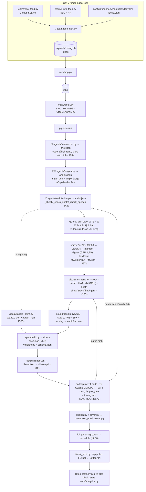

# ARCHITECTURE — exp-create-video theo code thật — 2026-11-16

Bổ sung cho `HE-THONG.md` (dừng ở 2026-10-05). Mọi đường dẫn là `src/create_video/…` nếu không ghi khác.
Thời gian = trung vị 40 video gần nhất từ `state.json` (V, 2026-11-16).

## 1. Luồng dữ liệu một video

## 2. Ranh giới và interface

| Interface | Bên sinh → bên dùng | File | Tính chất |
|---|---|---|---|
| `brief.json` | researcher → angles, scriptwriter, T4 | `agents/researcher.py` | facts có `quote` đã khớp snapshot |
| `angles.json` | angles → scriptwriter | `agents/angles.py` | 5 phương án + điểm Copeland |
| `script.json` | scriptwriter → mọi bước sau | `agents/scriptwriter.py:83-133` | `lines = [hook, *sections, cta]`; `shots[].line` neo shot vào câu |
| `tts/tts.json` | voice → spec | `pipeline.py:680-706` | span theo câu + từ (timestamp aligner) |
| **`video-spec.json`** | **Python → Remotion (duy nhất)** | `spec/schema.json`, `remotion/src/types.ts` | v1.3, `additionalProperties:false` |
| `qc/round-<n>.json`, `qc/decision.json` | qc.loop → web, lịch | `qc/loop.py` | `publishable`, `final_mp4` |
| `result.json` | publish → web worker | `publish.py` | worker coi job xong khi có file |

## 3. State, checkpoint, cache

`team/state.py`: mỗi stage `{status, input_hash, outputs, started_at, finished_at, wall_sec}`, ghi atomic (tmp + `os.replace`).

| Bước | Khoá cache | Chạy lại khi |
|---|---|---|
| research | file `brief.json` tồn tại | `--force` |
| angle | `angles.json` + hash chủ đề | đổi chủ đề |
| script | file `script.json` tồn tại (hash chỉ để log) | `--force` hoặc QC patch |
| TTS | sha256 từng câu (text sau pronounce, voice, seed, ref) + hash toàn bước | câu đổi |
| screenshot | sha256(url + highlight) — `exp/screenshot-cache` | url/highlight đổi |
| demo | sha256(`v3:url`) — `exp/demo-cache` | url đổi |
| stock | `stock/chosen.json` (đã chọn) + ledger 7 ngày | — |
| ảnh AI | hash prompts + model cfg + manifest | prompt đổi |
| depth, spec, render, mix | **không cache** | luôn chạy |

Hệ quả: một vòng sửa hình chỉ sinh lại ảnh hỏng, nhưng **luôn render lại toàn bộ** (Remotion không có render theo đoạn).
Trung vị một vòng sửa: 412s (vòng 0), 233s (vòng 1).

## 4. GPU — tuần tự

| Khối | Thiết bị | Đỉnh VRAM | Cách nhả |
|---|---|---|---|
| VieNeu TTS | CPU (ONNX) | 0 | worker process đóng cuối bước |
| LavaSR | GPU subprocess | ~91 MiB | thoát process |
| Qwen3-ForcedAligner | GPU subprocess | ~1,9 GB | thoát process |
| Qwen3-ASR (kiểm hook) | GPU subprocess | (exp-echo) | thoát process |
| FLUX.2-klein / SDXL | GPU, offload | 624 MiB (SDXL) | trong process pipeline, `empty_cache` |
| Depth-Anything-V2-S | GPU | nhỏ | — (bị tính rồi bỏ khi layout bật) |
| Qwen3-VL-2B nf4 (T2) | GPU subprocess | 4228 MiB (đo 1116) | thoát process; bỏ qua nếu VRAM rảnh < 2500 MiB |
| ACE-Step | CPU, cgroup 16G | 0 | subprocess |

Kiểm `nvidia-smi` chỉ ở lúc nhận job (`web/worker.py:93-100`) và trước T2 (`qc/loop.py:66-72`).

## 5. Agent Claude (mỗi vai = 1 lần `query()`, context mới, JSON schema)

| Vai | max_turns / USD | Timeout | Chi phí đo 1116 (V) |
|---|---|---|---|
| researcher (WebSearch, WebFetch) | 40 / $5 | — | $0,86 · 176s |
| angle_gen | 4 / $2 | 300s | $0,27 |
| angle_judge | 4 / $2 | 240s | $0,15 |
| scriptwriter (×2 lần thử) | 6 / $3 | **không** | $0,84 + $0,45 |
| critic_t3 | 4 / $2 | — | $0,15 |
| claim_extractor + fact_checker | 4 / $2 | — | $0,11 + $0,34 |
| **Tổng video 1116** | | | **$3,16 quy đổi** (trừ hạn mức gói) |

Retry vai (`team/role.py:96-183`): 2 lần (30s, 90s) chỉ khi lỗi "tạm thời"; `structured_output` rỗng = lỗi.

## 6. Hai kênh

`configs/channels/<id>/channel.yaml` — `ai` (Xưởng AI) và `meo` (Sống Khéo): pillar, dạng video (AI 8, mẹo 7), shot_kinds
(AI có `demo`, `code`; mẹo có `chat`), tỉ lệ cảnh thật (AI 0,25 · mẹo 0,4), `montage_sec` (mẹo 1,5), luật T4 tier1 (mẹo),
hậu tố prompt ảnh, nhạc, lịch đăng (`posting.slots: ["17:30"]`). Mọi luật kênh đọc qua `channel.current()`.

## 7. Dịch vụ

systemd user: `xuong-web`, `xuong-worker`, timer `xuong-lich` (1 phút), `xuong-kiemdang` (giờ), `xuong-stats` (3h).
Phụ thuộc ngoài: `exp-echo` (aligner, ASR), Kaggle (clip động), Pexels/Pixabay (stock), Buffer (đăng), Tailscale Funnel.
